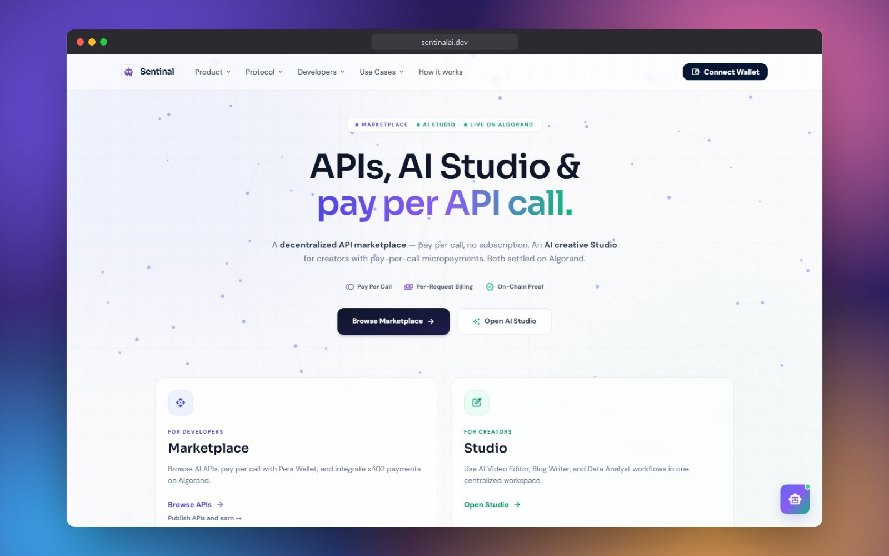
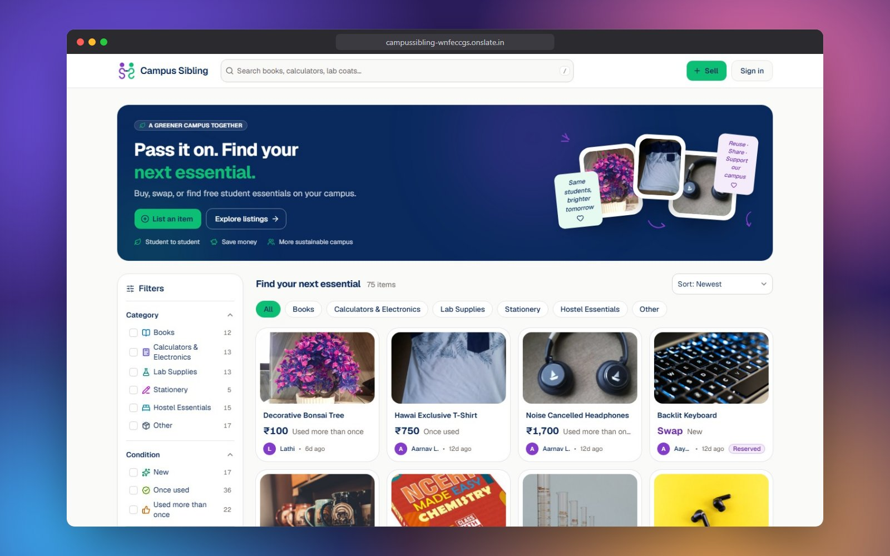
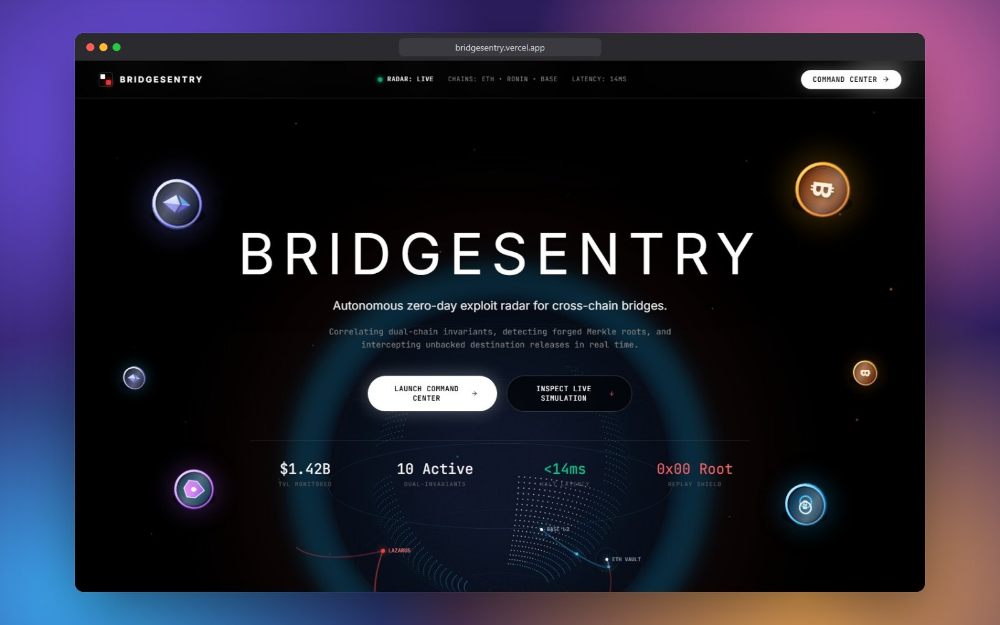
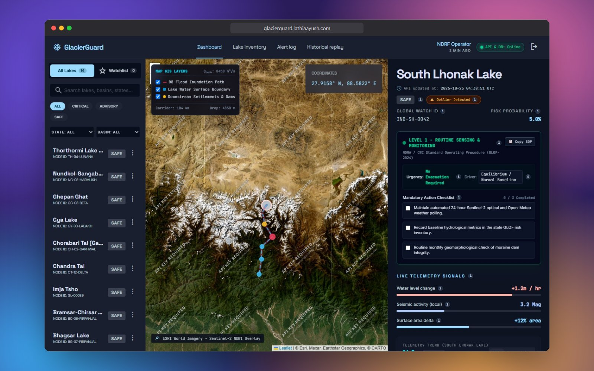
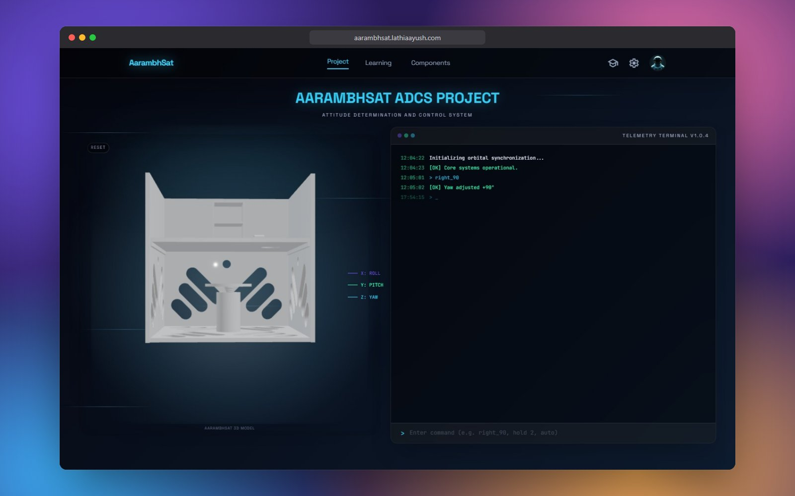
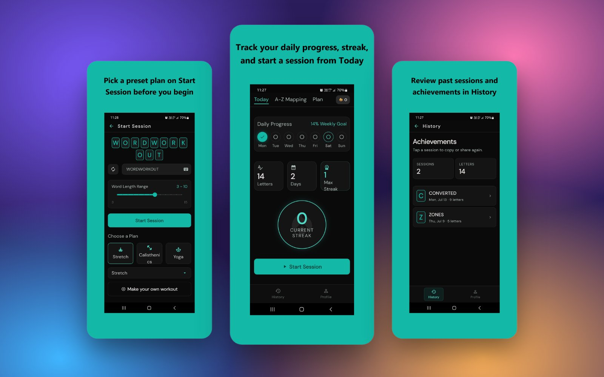

  

   

  
  
  
  

---

## LeetCode

<!-- LeetCode Stats Card -->

---

## Namaste ! 👋

- I am a student of **Computer Engineering**.
- I love **Logic & Programming** from the bottom of my CPU.
- I find joy in the art of creation, whether it's crafting a meaningful quote or writing elegant code.
- I build across **fintech, blockchain, IoT, and full-stack systems** — from CubeSat ADCS to pay-per-use AI marketplaces.

---

## Featured Projects

<table>
<tr>
<td width="55%"></td>
<td width="45%">

### [SentinalAI](https://github.com/lathi-aayush/pay-per-usage-ai-api-access-system-using-algorand)

Pay-per-call AI API marketplace and AI Studio, settled on Algorand with x402 micropayments.

🏆 **Top 3 · ₹10k prize**, Algorand National Hackseries · selected for the Goa round

[Live ↗](https://sentinalai.dev) · [Code](https://github.com/lathi-aayush/pay-per-usage-ai-api-access-system-using-algorand)

</td>
</tr>
<tr>
<td width="55%"></td>
<td width="45%">

### [Campus Sibling](https://github.com/lathi-aayush/campus-sibling)

Buy, swap or give away books, calculators and lab gear within one campus.

🛠️ Hackathon build · live with 75+ listings, full list → request → chat → handover loop

[Live ↗](https://campussibling-wnfeccgs.onslate.in) · [Code](https://github.com/lathi-aayush/campus-sibling)

</td>
</tr>
<tr>
<td width="55%"></td>
<td width="45%">

### [BridgeSentry](https://github.com/lathi-aayush/cross-chain-bridge-exploits-detection)

Real-time exploit radar for cross-chain bridges: dual-chain invariants, forged Merkle-root detection, automatic circuit breaking.

🛠️ Hackathon build · 0 false positives on normal load, sub-10 ms alerts

[Live ↗](https://bridgesentry.vercel.app) · [Code](https://github.com/lathi-aayush/cross-chain-bridge-exploits-detection)

</td>
</tr>
<tr>
<td width="55%"></td>
<td width="45%">

### [GlacierGuard](https://github.com/lathi-aayush/Glacier-Flood-Early-Warning-System-Platform)

Early warning for glacial-lake outburst floods: satellite + weather signals, per-lake risk and action checklists.

🛠️ Hackathon build · monitors 14 Himalayan lakes

[Live ↗](https://glacierguard.lathiaayush.com) · [Code](https://github.com/lathi-aayush/Glacier-Flood-Early-Warning-System-Platform)

</td>
</tr>
<tr>
<td width="55%"></td>
<td width="45%">

### [AarambhSat](https://github.com/lathi-aayush/attitude-determination-control-system-of-cubesat)

CubeSat attitude control: reaction-wheel stabilisation, MPU6050 / LDR sensing, 3D-printed chassis, interactive 3D site.

🛰️ Real hardware, controllable from a live telemetry terminal

[Live ↗](https://aarambhsat.lathiaayush.com) · [Hardware](https://github.com/lathi-aayush/attitude-determination-control-system-of-cubesat) · [Website](https://github.com/lathi-aayush/website-attitude-determination-control-system-of-cubesat)

</td>
</tr>
<tr>
<td width="55%"></td>
<td width="45%">

### [Word Workout Generator](https://github.com/lathi-aayush/install-word-workout-generator-app)

One random word becomes your workout: each letter maps to an exercise. Flutter + Firebase.

📱 Installable Android app with streaks and shareable summaries

[Install ↗](https://github.com/lathi-aayush/install-word-workout-generator-app)

</td>
</tr>
</table>

---

## All Repositories

<!-- REPOS:START: generated by tools/update-readme.mjs, edit tools/readme-config.json instead -->
| Repository | Description | Language | Stars |
|:---|:---|:---|:---:|
| [Supply-Chain-Disruption-Control-Agent](https://github.com/lathi-aayush/Supply-Chain-Disruption-Control-Agent) | seed42 — supply-chain disruption recovery simulator & agent control room | TypeScript / Next.js | ⭐ 0 |
| [attitude-determination-control-system-of-cubesat](https://github.com/lathi-aayush/attitude-determination-control-system-of-cubesat) | CubeSat ADCS with reaction wheel + MPU6050 | TypeScript | ⭐ 1 |
| [pay-per-usage-ai-api-access-system-using-algorand](https://github.com/lathi-aayush/pay-per-usage-ai-api-access-system-using-algorand) | SentinalAI — pay-per-use AI marketplace on Algorand | JavaScript | ⭐ 3 |
| [install-word-workout-generator-app](https://github.com/lathi-aayush/install-word-workout-generator-app) | Word Workout Generator — fitness from random words | Flutter | ⭐ 2 |
| [ASEP2-Sortify-Machine](https://github.com/lathi-aayush/ASEP2-Sortify-Machine) | Sortify — IoT + CNN dry-waste classifier | C++ | ⭐ 0 |
| [google-authenticator-extension](https://github.com/lathi-aayush/google-authenticator-extension) | Offline desktop TOTP Chrome extension | JavaScript | ⭐ 1 |
| [Glacier-Flood-Early-Warning-System-Platform](https://github.com/lathi-aayush/Glacier-Flood-Early-Warning-System-Platform) | GlacierGuard — GLOF risk screening dashboard | TypeScript | ⭐ 0 |
| [fhenix-enabled-pay-per-ai-api-usage-access-system](https://github.com/lathi-aayush/fhenix-enabled-pay-per-ai-api-usage-access-system) | FHE-encrypted AI API payments via Fhenix | JavaScript | ⭐ 0 |
| [vibe-to-structure-mcp](https://github.com/lathi-aayush/vibe-to-structure-mcp) | MCP server — vibe ideas → structured projects | — | ⭐ 0 |
| [ASEP1-Auto-Waste-Segregator](https://github.com/lathi-aayush/ASEP1-Auto-Waste-Segregator) | Auto waste segregator product UI / Sortify precursor | HTML | ⭐ 0 |
| [waste-stats](https://github.com/lathi-aayush/waste-stats) | Interactive waste management dashboard for Indian cities | JavaScript | ⭐ 0 |
| [multiprogramming-operating-system](https://github.com/lathi-aayush/multiprogramming-operating-system) | Simulated MOS — paging, interrupts, VM execution | C | ⭐ 0 |
| [Operating-System-Codes](https://github.com/lathi-aayush/Operating-System-Codes) | Operating systems practice codes | C++ | ⭐ 0 |
| [PFE-Lab-Answers](https://github.com/lathi-aayush/PFE-Lab-Answers) | Python for Engineers lab solutions | Python | ⭐ 1 |
| [AE-Lab-Experiments](https://github.com/lathi-aayush/AE-Lab-Experiments) | AE lab experiments collection | C++ | ⭐ 0 |
| [Projects-by-Lathi-Aayush](https://github.com/lathi-aayush/Projects-by-Lathi-Aayush) | Early project showcase site | HTML | ⭐ 1 |
| [campus-sibling](https://github.com/lathi-aayush/campus-sibling) | Campus Sibling — campus buy / swap / give-away marketplace | JavaScript / React | ⭐ 0 |
| [cross-chain-bridge-exploits-detection](https://github.com/lathi-aayush/cross-chain-bridge-exploits-detection) | BridgeSentry — real-time cross-chain bridge exploit detection | TypeScript | ⭐ 0 |
| [decentralised-excess-energy-marketplace](https://github.com/lathi-aayush/decentralised-excess-energy-marketplace) | GridLink P2P — peer-to-peer solar energy trading on Algorand | JavaScript | ⭐ 0 |
| [website-attitude-determination-control-system-of-cubesat](https://github.com/lathi-aayush/website-attitude-determination-control-system-of-cubesat) | AarambhSat interactive 3D website + telemetry terminal | TypeScript | ⭐ 0 |
| [dynamic-routine-planner](https://github.com/lathi-aayush/dynamic-routine-planner) | Weekly routine & timetable planner with collision detection | Python | ⭐ 0 |
<!-- REPOS:END -->

---

## Tech Stack I have worked with

**Languages**

**Frontend**

**AI & Agent Systems**

**Backend / APIs**

**Data / Infra**

**Blockchain**

**Embedded / IoT**

**Core**

---

## GitHub Analytics

   

  

   

  

